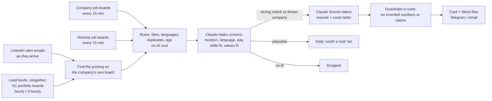

# JobRadar

**Be one of the first applicants, with an application that's actually yours.**

Most roles get 100+ applications within hours, and recruiters read the first few dozen. JobRadar watches the career pages of companies you care about, the big remote job boards and (optionally) your LinkedIn job alerts. It screens every new role against your skills *and* what you value in a company, tailors your resume and cover letter from your own material, checks the AI didn't invent anything, and sends you one tidy notification with the files and an Apply button.

**You always apply yourself.** JobRadar never submits anything, never logs into job sites, never scrapes LinkedIn.

Built with [n8n](https://n8n.io) and [Claude](https://claude.ai). Free and open source (MIT).

```
🎯 Mid-Market Account Executive (EMEA)
🏢 n8n ⭐ · 📍 Remote - EMEA
📊 87/100 (skills 85 · values 80) · 💶 €130K – €160K OTE · 🕒 22 min ago
✨ Full-cycle AE on a technical product, annual contracts
💚 remote-first: "work from anywhere"
✏️ Resume: summary rewritten · 2 bullets reworded — see "What changed"

⚠️ Check before sending
• MEDDPICC is required — your resume doesn't claim it

[🚀 Apply] [📄 Job post]
[👤 Jane (hiring manager)] [🔎 Recruiters]
[📋 Copy LinkedIn note]
[✅ Applied] [⏭ Skip]
📎 Your_Name_Resume_n8n.docx · Your_Name_Cover_Letter_n8n.docx · Your_Name_What_Changed_n8n.docx
```

**Contents:** [Setup](#setup) · [How it works](#how-it-works) · [How to use it](#how-to-use-it) · [Commands](#commands) · [Troubleshooting](#troubleshooting) · [Privacy](#privacy) · [For developers](#for-developers)

---

## Setup

About 20 minutes. Works on **Mac, Windows (via WSL) and Linux**. Click-by-click for each: [docs/GETTING_STARTED.md](docs/GETTING_STARTED.md).

### What you need

1. **Docker**: [Docker Desktop](https://www.docker.com/products/docker-desktop/) on Mac or Windows (Windows: with WSL/Ubuntu), Docker Engine on Linux. Open it.
2. **A Claude API key**: [platform.claude.com](https://platform.claude.com) → API keys, with ~$10 of prepaid credit. **No Claude subscription needed** — not Pro, not Max; JobRadar runs on pay-as-you-go API credit. If you happen to have Max, Ultra or Team, those plans include monthly API credits you can use instead (link your Console org under claude.ai Settings → Billing). Expect roughly $10–20 a month (estimate; check your usage page after week one).
3. **Somewhere to be notified**: Telegram (a bot you create in a minute with @BotFather) and/or email (Gmail, Outlook, iCloud or any SMTP/IMAP mailbox with an app password).
4. **Your CV as a PDF** (Word: Save as PDF · LinkedIn: your profile → More → Save to PDF).

### Install

```bash
git clone https://github.com/blockgeneral/jobradar.git
cd jobradar
./jobradar setup
```

The setup wizard:
1. tests your Claude key,
2. connects Telegram (it finds your chat by itself) and/or email,
3. **imports your CV** and gives you an honest review plus your starting files, in about a minute,
4. takes your list of companies (career-page links or just names; `*` marks a dream company),
5. starts everything and runs a first search. **Within a few minutes you get your 3 best matches from the last 7 days.**

After that, new matches arrive within ~15 minutes of being posted.

### Make it yours: the interview

The CV import gets you started; the interview makes the applications sound like you. Open the chat (`./jobradar chat`) and say **"interview me"**: it asks the open questions from your CV review one at a time and saves your answers. For a deeper session, the [onboarding interview](onboarding/README.md) is a 30-minute conversation in the Claude app, like an intake call with a recruiter (voice works). Either way you end up with four files in `candidate/`:

| File | What it is |
|---|---|
| `experience_inventory.md` | Everything true about your work, plus what you must never claim. Tailoring may use any fact here, and nothing else. |
| `resume_base.md` | Your master resume. |
| `cover_letter_base.md` | Your letter in your words. Only three slots change per job; the rest stays word for word. |
| `search_profile.md` | Your must-haves (where you can work, languages, pay), the roles you want, and **what you value in a company**, ranked. |

### Optional: LinkedIn job alerts

If you use LinkedIn job alerts, JobRadar can read those emails too, as a safety net:

```bash
./jobradar linkedin
```

It asks for the mailbox your alerts go to and an **app password** (Gmail: [myaccount.google.com/apppasswords](https://myaccount.google.com/apppasswords), needs 2-step verification), tests the login, and switches it on. Your existing alerts need nothing else. `./jobradar linkedin off` stops it. How it works: [LinkedIn alerts](#linkedin-alerts-without-scraping).

---

## How it works



### Where jobs come from

| Source | How | Speed |
|---|---|---|
| Company career pages on Ashby, Greenhouse, Lever, Workable, Recruitee, Personio, SmartRecruiters, Pinpoint | their public job-board feeds | minutes after publishing |
| Companies without a supported careers page | watched by name across every board below | as fast as the board |
| We Work Remotely, Remotive, RemoteOK, Jobicy, Himalayas | public feeds | minutes to hours |
| [Open Abroad](https://openabroad.org) | its public feed of roles that hire across borders, each tagged with who can apply | hourly |
| [TrulyRemoteWork](https://trulyremotework.com) | its documented JSON feed of worldwide-remote roles | every 30 min |
| Workable job search (every Workable career page) | the cross-company search, per phrase in `boardQueries` and place in `workableSearch` | hourly |
| [Jobgether](https://jobgether.com) | its official API for agents (remote-friendly roles by country). Listings have no full text, so each one is looked up on the company's own job board first; otherwise a title-only card | hourly |
| European VC portfolio job boards (Point Nine, Atomico, Creandum, Speedinvest, Earlybird, MMC, OpenOcean, firstminute, byFounders) | each board's public job sitemap, then that job's page | every 3 hours |
| Hiring Cafe | the community [Hiring Cafe MCP server](https://hiringcafe-mcp.vercel.app/) (unofficial), or an Apify task | hourly |
| LinkedIn job alerts (optional) | your own alert **emails**, read from your inbox (left unread) | as often as LinkedIn emails you |

### How it decides

1. **Rules first, no AI cost:** job titles you want or don't, languages you don't speak, jobs you've already seen, and postings older than 3 days (`filters.freshHours`).
2. **Claude Haiku screens** what's left against your search profile: can they hire you where you live, does it work in English, does pay clear your floor. Then two scores: **skills fit** and **values fit** (how well the company matches what you said you value), plus an overall score out of 100.
3. **Three outcomes:**
   - Both fits ≥ 50 and overall ≥ 75 (`scoring.instantAt`), or a **dream company**: **Claude Sonnet** tailors your files and you get a card right away.
   - Both fits ≥ 50 but overall lower: one line in the next daily **"worth a look"** list (08:00 by default), no tailoring, no ping.
   - Anything else: dropped.
4. **On every card:** where the employer says it hires, quoted from the posting (or "🗺️ Location unverified" when the posting never says, whatever the board's label claims), an **outbound-heavy** warning when the role is mostly self-sourcing pipeline, and the **RepVue** rating you noted for the company (`companies[].repvue`, or tell the chat "n8n is 4.5 on RepVue").
5. **Guardrails in plain code** check every tailored file: any number not in your files, anything on your never-claim list, a missing section or changed contact details → a ⚠️ line on the card. A **"What changed"** file shows exactly what was edited versus your base resume.
6. **Discovery:** companies that keep matching your values but aren't on your list show up in your Monday report with a ➕ button.
7. If Claude is down or out of credit, you still get the job, marked as not screened, with your base files.

### Dream companies, reposts and relocation

- **Dream companies** (`"dream": true`) get a lower bar: every role that isn't excluded by title is screened, and every match is tailored and sent right away.
- **Reposts:** companies often repost a role under a new ID, or keep the old date. A dream-company role you never got a card for comes through again, whatever its date says. Roles you already got a card for never repeat.
- **Relocation:** if you'd move for a company (say it sponsors visas), add `"relocateTo": ["United Kingdom", "Ireland"]` to it. Roles based there count as hireable for that company only, and its open roles get one fresh look.

### LinkedIn alerts without scraping

JobRadar never opens LinkedIn. It reads LinkedIn's alert **emails** in your inbox the moment they arrive, leaves them unread, and for each job in the email:

1. looks for the same posting on the company's own job board (one you watch, one it found before, or a guess at their public Ashby, Greenhouse or Lever board);
2. **found:** full screening on the real job description, tailored files, a normal card, even if the posting looks old;
3. **not found:** it's judged on title, company and location only. LinkedIn's location is taken literally: "London (Remote)" means remote within the UK. A strong match gets a **title-only card** with an "Open on LinkedIn" button, nothing tailored; a plausible one goes to the daily list.

A job you already got a card for never comes through twice, whichever source it comes from. If LinkedIn changes its email format and JobRadar can't read an alert, you get a heads-up the same day.

Good to know: each LinkedIn alert email lists LinkedIn's top 6 jobs, even when the subject says "…and 39 others". And LinkedIn only knows jobs posted on LinkedIn: some companies (n8n, for example) don't list there, which is why their own job board is the main source.

---

## How to use it

### Every day

- A card arrives. Read the ⚠️ lines and the "What changed" line, open the Word files, fix anything, then tap **🚀 Apply**.
- Tap **✅ Applied** or **⏭ Skip** so your stats stay honest. (Email: the buttons open a pre-filled email; just hit send.)
- Tap the **👤 named contact**, **🔎 Recruiters** or **🔎 Hiring team**, and **📋 Copy LinkedIn note** to reach a human the same day.
- Each morning: the **"worth a look"** list with plausible roles that weren't strong enough for a ping.
- **Every Monday:** a report with what was found, what you applied to, responses, rejections, intro calls and how fast you were. On the 1st of each month, a 30-day roll-up. Both ask "what happened with these?" with one-tap answers.

### Change anything by chatting: `./jobradar chat`

After setup you don't need the terminal or a text editor. Open the chat page (`./jobradar chat`, or bookmark the link it prints; sign in with your local n8n login) and say what you want, in your own words:

- "watch Supabase as a dream company" · "stop watching Deel"
- "only ping me for scores above 70" · "no notifications between 23:00 and 07:00" · "turn off Remotive"
- "I'd relocate to the UK or Ireland for Anthropic, they sponsor visas"
- "I won't take roles that need 5 years of enterprise sales" · "I'm fine with hybrid in Vienna"
- "remember: I ran partner payouts every month" · "never say 'a few partners'" · "interview me"
- "why was it quiet today?": real numbers from the last runs, and any broken source
- paste a job link: screened right away, tailored, and sent as a normal card (even if your filters would skip it, with the reason)

It shows every change before → after and saves only when you say **yes** (a backup of the old file is kept). It runs on your own Claude key (a cent or two per message), only you can open it, and it never applies or messages anyone for you.

### Quiet nights

`notifications.quietHours` with `"pause": true` (or tell the chat "no notifications between 23:00 and 07:00"): the radar doesn't run in that window, so you get no messages at night. LinkedIn alert jobs that arrive meanwhile wait and are checked first thing after; at most 4 tailored cards go out per run, so mornings don't start with a wall of cards. Runs you start yourself still go through. Without `pause`, Telegram simply arrives silently in that window.

### Settings by hand: `settings.json`

Everything about *what* to find and *how* to notify lives in one file. Changes apply on the next run. Highlights (full reference: [docs/SETTINGS.md](docs/SETTINGS.md)):

- `companies`: career-page links (`https://jobs.ashbyhq.com/n8n`), or just a name (`{ "name": "PetsApp" }`) to spot a company on every job board. `"dream": true` for dream companies, `"relocateTo": [...]` for companies you'd move for. Or run `./jobradar companies`.
- `scoring.minSkillsFit` / `minValuesFit` / `instantAt`: when a role appears at all (both fits ≥ 50) and when it's worth a ping (≥ 75). To get fewer pings, raise `instantAt`.
- `filters`: job titles to keep or drop, languages you don't speak, how old a posting may be.
- `notifications`: `style` (`compact` or `detailed`), `files` (`docx`, `pdf` or both), `delivery` (`instant` or one `digest` a day), `quietHours`, `buttons`.
- `reports`: weekly day/time, monthly roll-up.
- `replyDetection.enabled`: email users only. JobRadar reads new mail that mentions a company you applied to, and Claude labels it reply / rejection / interview.
- `guardrails.neverClaim`: things that must never appear in your resume (it warns you if they do).

Keys and channels live in `.env` (run `./jobradar setup` again, or edit it and `./jobradar restart`).

### Email users: no inbox clutter

JobRadar sends to your plus-address (`you+jobradar@gmail.com`). The setup writes a `gmail-filter.xml`; import it once (Gmail → Settings → Filters → Import) and every JobRadar email skips your inbox and lands under a **JobRadar** label. Turn on notifications for that label in the Gmail app so matches still reach your phone.

### Editing the files yourself

Every job gets a folder in `output/` with the Word/PDF files plus editable `resume.md` and `cover_letter.md`. Edit those, then `./jobradar rerender <folder>` to rebuild the files.

### Keeping it running

It runs while your computer is awake and Docker is open. On a Mac, keep it plugged in with "Prevent automatic sleeping when the display is off". For true 24/7, put the same folder on a small Linux server (~€4/month) and run `./jobradar setup` there.

---

## Commands

```
./jobradar setup        first-time setup (safe to re-run to change anything)
./jobradar chat         change anything in plain words (opens the chat page)
./jobradar linkedin     also read your LinkedIn job-alert emails (needs an email app password); "linkedin off" to stop
./jobradar run          check the job boards right now
./jobradar companies    add companies (paste career-page links)
./jobradar import-cv    import a CV (PDF) → honest review + your candidate files
./jobradar rerender X   rebuild the Word/PDF files after editing output/X/*.md
./jobradar report       send the weekly report now (or: report monthly)
./jobradar status       what's running, which companies, latest jobs
./jobradar update       get the latest version (keeps your data)
./jobradar start | stop | restart | logs
```

Inside n8n (http://localhost:5678) you'll find nine workflows (one is the chat, one reads LinkedIn alerts if you switch it on, one reads the lead feeds) and two tables: **jobradar_jobs** (your application tracker) and **jobradar_watch** (companies you added with ➕), both viewable and editable there.

## Troubleshooting

- **Nothing arrives:** ask the chat "why so quiet?", or check n8n → Executions. The first run only sends jobs from the last 7 days; later runs only *new* jobs. With a night pause on, nothing runs in that window.
- **🩺 source alert:** a source failed 3 runs in a row (one-off outages stay quiet), so a company link probably moved or a board changed. Fix it in the chat or in `settings.json`.
- **Claude 401/credit errors:** check the key and credit at platform.claude.com, then `./jobradar restart`.
- **Telegram "chat not found":** send your bot a message, run `./jobradar setup` again.
- **Gmail login fails (email or LinkedIn alerts):** you need an *app password* (2-step verification on), not your normal password.
- **"Couldn't read a LinkedIn alert":** LinkedIn changed its email format. Everything else keeps working; open an issue with the alert attached (remove your name first).

## Privacy

Everything runs on your machine. Your files, tracker and keys never leave it, except the job text and your profile sent to Claude for screening and tailoring, and the notifications you chose. LinkedIn alerts are read over IMAP from your own mailbox and left unread; nothing else in your inbox is processed (reply detection is a separate opt-in). `candidate/`, `settings.json`, `.env` and `output/` are git-ignored.

## For developers

- Workflow logic lives in `src/` (`lib/` shared helpers, `wf/` one block per n8n Code node) and is compiled into `workflows/*.json` by `node build/build.js`. Never hand-edit `workflows/*.json`.
- `node test/unit.js`: adapters, filters, guardrails, notifications, LinkedIn parsing (fixtures shaped like real alert emails), reposts, relocation, night pause, chat, email/reply/digest logic.
- `N8N_BIN=/path/to/n8n bash test/e2e.sh`: boots a real n8n, imports all workflows, runs search → notify → button presses → weekly report → chat → a LinkedIn alert batch → lead feeds (incl. workflow 8 itself) against mock boards, Claude, Telegram and SMTP; the renderer makes real Word files. `E2E_CANDIDATE=examples/candidate E2E_SETTINGS=$PWD/examples/settings.json E2E_EXPECT=1` runs the same as a fictional backend engineer.
- `N8N_BIN=/path/to/n8n bash test/setup-wizard.sh`: runs the real `./jobradar setup` as a brand-new user from a clean checkout, with `test/fake-docker` standing in for containers.
- Architecture notes: [docs/ARCHITECTURE.md](docs/ARCHITECTURE.md).

## License

MIT. Use it, fork it, improve it. If it lands you a job, tell us.
